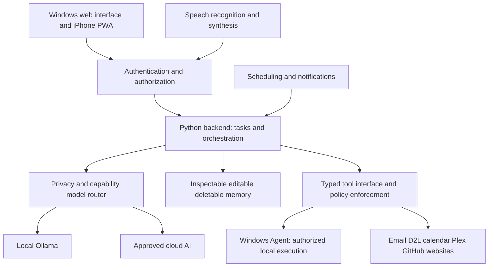

# Architecture

## Implemented in Phase 1 Task C
backend/main.py exposes app and a Python launcher. The launcher validates settings before passing the approved host/port to Uvicorn. FastAPI lifespan revalidates before serving and logs startup/shutdown. backend/core/config.py provides immutable Pydantic Settings, optional working-directory .env loading, input validation and disabled-feature enforcement. backend/core/logging.py emits redacted JSON console records. backend/core/security.py defines permission categories and denies every executable action without executing anything. backend/api/health.py returns a typed deterministic response using the configured name and installed package version. No workers, database or outbound service clients are started.

Tests isolate environment variables and dotenv files. scripts/verify_backend.py performs a live Windows loopback and shutdown check. This is configuration/policy foundation, not authentication or a production authorization platform.

## Planned complete system
Every component in the following diagram beyond the minimal backend status/configuration/logging/policy foundation remains planned. The authentication gate, orchestration, router and executable tool dispatch do not exist yet.

## Components and ownership
The Python backend now exposes a minimal FastAPI health interface; future tasks will add task coordination. backend/core owns configuration, routing and orchestration; backend/agents owns future task-level agent coordination, not direct Windows access. backend/skills owns explicit typed tool contracts and policy-aware dispatch; backend/api owns request/response boundaries. No class hierarchy or tool framework is prescribed yet.

The router will consider complexity, privacy, connectivity, capability, latency, cost and user preferences. Routine suitable requests may use local Ollama; complex tasks may use approved cloud AI. Sensitive school records and private files require authorization and data minimization before cloud submission. Track usage and budget limits; fail safely when a provider is unavailable.

The Windows Agent is a separate execution component for approved system metrics, applications, scripts, diagnostics and GUI interactions. Keep Windows-specific dependencies there. Typed authenticated requests must be checked against policy before execution; model output is never executable authority. Return bounded structured results with audit identifiers and cancellation support.

backend/integrations will adapt official authenticated email, calendar, Brightspace, Plex and development-service APIs. Browser automation is a later permitted fallback. Never bypass institutional authentication or MFA. Avoid duplicate calendar events and repeated side effects.

backend/memory will own durable context, initially considering SQLite, with provenance, retention and inspect/edit/delete controls. Credentials belong in a separate secure store. Voice will handle speech recognition, synthesis, audio sessions, privacy controls and optional wake words; placement will be chosen in Phase 3. No voice dependency is needed now.

The future Next.js/TypeScript frontend and iPhone PWA share backend identity, permissions and memory. iOS background and system-control limits must be respected. A future authenticated always-on VPS coordinator may host the portable core while the Windows Agent remains local; Windows actions are unavailable while that agent is offline.

## Data flow and trust boundaries
1. An authenticated user submits text or voice; validate the request and determine authorization.
2. Core retrieves only relevant authorized memory and integration data, labeled as untrusted content.
3. Router selects an allowed model; redact and minimize cloud-bound data.
4. Model proposes a response or typed tool request. Independent policy checks, and explicit approval where required, precede execution.
5. Agent/integration returns bounded results; core records redacted audit details and sends the response to the authorized interface.

Scheduling uses the same policy boundary as interactive requests. Localhost binding is an initial default, not a substitute for authentication. Remote access requires an explicit later design, private authenticated transport and scoped permissions. See SECURITY.md for required controls and failure recovery.
